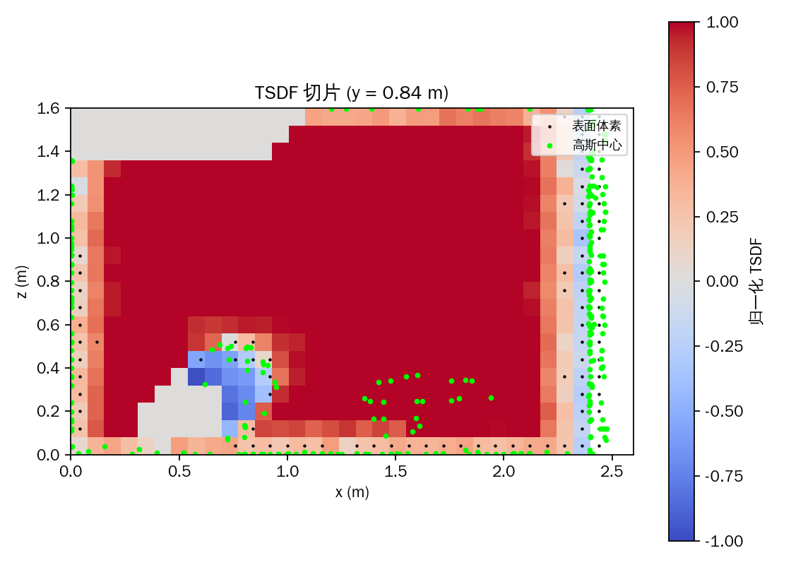

# Voxel-Anchored Gaussian Field：体素作为表征一部分的主动重建 demo

这个 demo 演示一套**体素-高斯联合表征**：体素网格不是 3DGS 之外的辅助规划地图，而是表征本身的骨架——
每个高斯锚定在一个表面体素上，体素的 TSDF、观测置信度和状态直接决定高斯的生成、形状、几何约束与删除。
系统在合成室内场景里完成：RGB-D 融合 → 表面体素 → 锚定高斯 → 体素几何约束优化 → 几何不确定度驱动的主动探索。



## 1. 为什么体素要成为表征的一部分

纯 3DGS 的光度损失对几何是欠约束的：同一组像素可以由不同深度/形状解释，弱纹理区域尤其严重；
3D 高斯是体积密度而不是表面，渲染深度是 alpha 加权的期望值。结果是“渲染好看、空间结构不准”。

体素层提供的是**显式、带置信度的几何先验**。把两者绑定成一个表征后：

- 体素决定高斯**在哪里存在**（只在表面带生成，自由/未知区域没有高斯）；
- 体素决定高斯**长什么形状**（法向帧、尺度上下界、中心活动范围）；
- 体素决定高斯**何时被删除**（锚点被后续观测改判为自由空间时剪枝）；
- 高斯用光度/深度损失反过来细化体素无法表达的表面细节，但**不回写占据状态**，避免 floaters 污染几何与规划。

## 2. 表征设计

### 2.1 体素层（`demo/voxel_map.py`）

稠密 TSDF 网格（demo 用 8 cm 体素，真实系统可换成 hash grid / nvblox）：

| 字段 | 含义 |
|---|---|
| `tsdf` | 归一化到 [-1,1] 的截断符号距离，正 = 自由空间，零 = 表面 |
| `weight` | 累积观测权重，同时作为置信度 |
| `color_sum / color_w` | 表面颜色累积，用于高斯初始化 |
| 派生状态 | `surface`: w>0.5 且 \|tsdf\|<0.35；`free`: w>0.5 且 tsdf>0.3；`unknown`: w<0.5 |

融合采用投影 TSDF：深度图先换算到与体素相同的射线距离度量，再按截断范围加权平均。
`unknown` 区域就是主动探索要补看的地方；`frontier` 是未知体素与自由体素相邻的边界。

### 2.2 高斯层（`demo/gaussians.py`）

每个高斯绑定一个表面体素 anchor `v`，参数化为：

```
中心:   mu = c_v + (voxel/2) * tanh(delta)          # 严格限制在锚点体素内
旋转:   R_g = R_frame(v) * Exp(theta_max * tanh(rho))  # TSDF 法向帧 + 限幅小旋转
尺度:   s = s_min + (s_max - s_min) * sigmoid(alpha)   # 限制在 [0.15, 2.5] * voxel
颜色:   c（RGB，demo 不做视角相关 SH）
不透明度: opacity = sigmoid(o)
```

- `R_frame` 由体素处 TSDF 梯度构造（切向 1、切向 2、法向三列），法向尺度初始化为 0.38 voxel、切向 0.75 voxel；
- 旋转只允许相对 TSDF 法向修正 ±14°，并加 L2 先验拉回——体素法向是先验，不是可随意放弃的初值；
- 新增表面体素时 `spawn`；锚点体素被改判为自由时 `prune_free_anchors`。这就是体素驱动的生命周期。

### 2.3 置信度

体素置信度 `conf = w / (w + w0)`（demo 中 w0=2）。所有几何损失都乘以 conf：
观测充分的表面约束强，弱观测/透明/超量程区域自动退化为 3DGS 主导。这是“体素是软先验而不是真值”的落点。

## 3. 几何约束损失（`demo/losses.py`）

总损失：

```
L = L_rgb + L_depth + lambda(t) * (1.2*L_surf + 0.5*L_norm + 1.5*L_free + 0.05*L_rot)
```

| 损失 | 公式 | 作用 |
|---|---|---|
| `L_surf` | `Huber(TSDF(mu) * trunc) * conf` | 把高斯中心拉向零水平集（三线性插值可微） |
| `L_norm` | `(1 - |n_g · grad TSDF(mu)|) * conf` | 高斯法向与 TSDF 梯度对齐 |
| `L_free` | `alpha * ReLU(TSDF(x) - 0.5) * conf(x)`，`x = mu + R_g S eps` | 高斯支撑域落入自由空间时压低不透明度/推回表面 |
| `L_rot` | `tanh(rho)^2` | 旋转不要偏离 TSDF 法向先验 |

课程调度 `lambda(t) = min(1, 0.4 + 0.3*t)`（t 为主动探索步）：早期体素稀疏时弱约束，随观测增多逐步加强——
对应“体素网格和 3DGS 一起逐步完善”。

## 4. 渲染器（`demo/renderer.py`）

一个用于演示的可微 ray-splat 渲染器：

1. 把光线变换到每个高斯的局部帧，计算光线到高斯中心的最近距离（按尺度归一化）；
2. `alpha = opacity * exp(-0.5 * d^2)`；
3. 按最近点深度排序，做标准 front-to-back alpha 合成，得到颜色、深度和累积不透明度。

它是 3DGS “投影→排序→合成”核心的简化版：没有 tile 并行、EWA 面积归一化和球谐视角相关颜色。
真实系统直接替换成 gsplat / diff-gaussian-rasterization 即可。

## 5. 主动探索（`demo/active.py`）

- **目标点**：未知 frontier 体素（权重 1.0）+ 低置信表面体素（权重 0.6）；
- **候选位姿**：房间内的自由位置 × 注视目标（房间中心、物体、四面墙、地板、天花板）；
- **效用**：视锥内、未被当前 TSDF 遮挡的目标权重和 − 30 × 直线路径长度；
- **选择**：跳过与已访问位姿过近的候选，取效用最大者，采集 RGB-D、融合、剪枝、生成新高斯、继续优化。

效用本质上是**几何不确定度**（哪里还没观测到 / 哪里观测不足），而不是渲染 PSNR。

### 5.1 强化学习驱动的主动探索（`--policy rl`，替换上面的手工效用）

手工效用的两个常数（目标权重 1.0/0.6、路径惩罚 30.0）是拍的，而且“看哪里”和“走多远”是同一个标量里
直接相减，量纲不一致。把这一层换成学习到的策略：**动作空间仍是同一组候选视点**（离散索引），
策略只负责“在信息量 / 路程 / 冗余之间怎么权衡”，几何部分完全沿用 §2 的体素-高斯表征。

形式化：候选排序 MDP。状态 = 当前 TSDF 地图 + 当前位置 + 已访问位姿集；动作 = 候选视点索引；
策略 π_θ 对每个候选独立编码后打分，softmax 得到选择分布；价值网络读候选特征的池化。

**动作空间不是人工设定的**：每个决策在房间自由空间里均匀重采样 K=64 个位姿（位置用拒绝采样
排除障碍内部；朝向朝房间内均匀采样的注视点），眼高在 0.45~1.45 m 内变化。策略对候选身份
无记忆（纯集合打分），所以每次重采样不影响训练；K 是算力旋钮，不是先验。
`demo/active.py` 里那张 4×3 位置 × 12 个手挑目标的表只留给启发式基线用。

14 维候选特征（全部只读地图，不用 GT，实现见 `demo/rl_active.py`）：

| 组别 | 特征 |
|---|---|
| 信息量 | `gain_unknown`、`gain_lowconf`、`visible_frac`、`visible_dist` |
| 效率 | `gain_per_dist`、`path_len`、`heading_cost` |
| 新颖度 | `novelty_pos`、`novelty_dir`、`seen_ratio` |
| 观测精度 | `depth_quality`（可见目标点上 1/(1+(z/1.5)²) × \|cos 视线法向\| 的均值：近且正对方可测准）、`height_dev` |
| 约束 | `wall_dist`、`bias` |

奖励三项，全部地图内可算：
`r = 1.0 × Δ表面体素/100 + 0.8 × 深度可分性 − 2.0 × 新深度与地图冲突比例 − 0.3 × 路程`
其中“表面体素”= `(weight>1) & (|tsdf|<0.6)`，与 §8 的覆盖率指标同口径（第一版用“全部已知体素”，
奖励方向和评测口径不一致，覆盖率因此偏低）；深度可分性对刚采集的一帧逐像素查 TSDF，
按距离与入射角加权，冲突项统计新深度与已有地图表面偏离超过 1.5 个截断带的像素比例。
GT 只在评估时算覆盖率，不进入训练。

训练协议（`train_rl.py`）：PPO，clip 0.2、GAE(γ=0.95, λ=0.95)、价值损失 0.5、熵 0.01、Adam 3e-4；
episode = 随机化场景（球/桌/柱位置±12 cm、半径与桌面厚度抖动）+ 随机 3~6 个初始视角 + 6 步决策。
场景随机化是为了不在“那一个房间”上过拟合，`eval_policies.py --randomize` 就是这项的检验。

**深度噪声是这两项奖励的前提**：`--noise 0.02` 按像素给深度加 σ=2 cm 噪声。
无噪声时“冲突”恒为 0、“可分性”几乎无区分度，奖励里的精度项等于不存在（实测过：
`|tsdf|` 阈值写法在归一化 TSDF 上取不到，已改为对已建立表面像素求 |TSDF| 均值，
σ=2 cm 时该值 0.28 左右，才有信号）。

奖励项消融（`ablate_rl.py`，2×2：w_quality ∈ {0, 0.8} × w_conflict ∈ {0, 2.0}，
四格均带 σ=2 cm 噪声训练 250 episode，再用同样噪声评估 12 episode）：

```bash
python ablate_rl.py                                   # 约 15 分钟
python ablate_rl.py --episodes 400 --noise 0.01       # 换预算/噪声
```

输出 `outputs/rl_ablation.json` 与 `outputs/rl_ablation.png`（覆盖率 / 深度可分性 / 路程 三联图），
对照组除启发式外还有 `ctrl`（两项都为 0，等价于只看 Δ表面 + 路程）。

与启发式的关系：地图、融合、损失、评估全部不变，只有“选哪个候选”这一行被替换；
`--policy heuristic` 是默认值，因此原有数字仍然可复现。

## 6. 代码结构

```
run_demo.py          端到端主流程、训练调度、评估、绘图（--policy heuristic|rl）
train_rl.py          PPO 训练主动探索策略（随机化场景 + 深度噪声，只读地图的奖励）
ablate_rl.py         奖励项消融：w_quality × w_conflict 的 2×2
eval_policies.py     同题对照：随机 / 启发式 NBV / 学习策略
noise_study.py       点云表征 vs 体素-高斯（噪声实验）
demo/scene.py        解析式室内场景：SDF、程序化颜色、GT RGB-D、GT 表面采样
demo/voxel_map.py    TSDF 融合、三线性查询（numpy/torch）、置信度与状态、frontier
demo/gaussians.py    锚定高斯的参数化、spawn/prune 生命周期
demo/renderer.py     可微 ray-splat 渲染
demo/losses.py       体素几何约束（表面/法向/自由空间/旋转先验）
demo/active.py       启发式 NBV：候选视点、可见性评分、效用选择
demo/rl_active.py    学习型 NBV：候选特征、策略网络、探索环境、PPO（§5.1）
demo/utils.py        相机 look-at、像素射线
```

## 7. 运行

环境（本机已验证）：Python 3.9 + torch 2.8 + CUDA，RTX 5070。依赖见 `requirements.txt`。

```bash
C:\Users\ixiuy\miniconda3\envs\Pytorch\python.exe run_demo.py
```

快速冒烟（约 10 秒）：

```bash
C:\Users\ixiuy\miniconda3\envs\Pytorch\python.exe run_demo.py --quick
```

点云对比与噪声实验（约 1 分钟）：

```bash
C:\Users\ixiuy\miniconda3\envs\Pytorch\python.exe noise_study.py
```

Windows 下也可直接双击 `run.bat`，或命令行 `run.bat --quick`。

常用参数：`--steps`（主动探索步数）、`--iters-per-step`、`--static-iters`、`--rays`、
`--max-gauss`、`--device cpu|cuda|auto`。

## 8. 输出与指标

`outputs/` 下：

- `metrics.json`：全部指标与配置（含逐视角分析）；
- `metrics_progress.png`：主动探索过程中的 Chamfer、法向误差、自由空间违规、覆盖率；
- `model_comparison.png`：同一体素初始化下的消融对比；
- `map_3d.png`：GT 表面、体素初始化、纯光度、体素约束四组高斯中心的空间分布；
- `tsdf_slice.png`：TSDF 切片、表面体素与高斯中心；
- `render_compare.png`：留出视角的颜色/深度渲染对比（GT、纯光度、深度监督、体素约束）；
- `depth_compare_models.png`：逐视角深度图对比（GT / 纯光度 / 纯光度误差 / 体素约束 / 体素误差）；
- `gt_views.png`：GT 视角集的彩色图 + 深度图（建模目标长什么样）；
- `gt_scene_3d.png`：GT 彩色表面点云 + 房间线框 + 相机轨迹（初始/主动/留出）；
- `render_vs_gt_views.png`：逐视角 GT 与体素约束模型的颜色/深度对比；
- `per_view_metrics.png`：逐视角深度 RMSE 与 PSNR 的分组柱状图；
- `pointcloud_noise_study.png`：点云 vs 体素-高斯在 0/1/2/4 cm 深度噪声下的四联指标曲线；
- `pointcloud_depth_compare.png`：σ=2 cm 时留出视角的 GT / 原始点云 / TSDF 点云 / 体素 GS 深度与误差；
- `pointcloud_noise_study.json`：噪声实验的完整数据。

指标定义：

| 指标 | 定义 |
|---|---|
| Chamfer | 高斯中心到 GT 表面采样点的最近距离（均值/P90，cm） |
| 法向误差 | 高斯法向与“中心投影到 GT 表面后的法向”的夹角（度） |
| 自由空间违规 | 中心处体素 TSDF>0.5（明显自由空间）且有权重的高斯比例 |
| 深度 RMSE | 留出视角渲染深度 vs GT 深度（cm，按累积不透明度掩码） |
| PSNR | 留出视角渲染颜色 vs GT 颜色 |
| 覆盖率 | 已观测表面体素 / GT 表面带体素 |

本机一次完整运行的结果：

| 模型 | Chamfer (cm) | 法向 (°) | 自由空间违规 (%) | 深度 RMSE (cm) | PSNR (dB) |
|---|---|---|---|---|---|
| 体素初始化（未训练） | 4.11 | 9.12 | 0.00 | 12.61 | 7.65 |
| 纯光度 3DGS | 4.28 | 14.09 | 6.48 | 14.02 | 16.79 |
| + 深度监督 | 2.81 | 14.57 | 0.37 | 4.56 | 14.13 |
| + 体素约束（本方法） | **2.17** | **9.45** | **0.12** | 4.88 | 14.74 |

解读：纯光度模型 PSNR 最高但几何最差（典型的“好看不准”）；深度监督显著改善几何；
体素约束在 Chamfer、法向保持和自由空间一致性上最好，同时渲染质量与深度监督相当。
法向误差接近初始化先验（9.1°），说明体素约束阻止了训练过程中法向漂移。

注意：PSNR 绝对值不高是简化渲染器和“每个 8 cm 体素一个高斯”的分辨率限制导致的，本 demo 的重点是几何指标。
主动探索过程中覆盖率从 18% 提升到 56%，Chamfer 从 2.12 cm 降到 1.84 cm（增量模型）。

### 8.1 GT 视角集与逐视角分析（补充）

`gt_views.png` 展示了 6 个 GT 视角的彩色图和深度图：初始视角 1/3、两个主动视角、一个高位分析视角和一个留出视角。
`gt_scene_3d.png` 用 GT 程序化颜色渲染的表面点云画出整个房间，并标出 4 个初始视角（蓝）、5 个主动视角（绿）和留出视角（橙）的位置与朝向。
`render_vs_gt_views.png` 则把同一组视角的 GT 颜色/深度与体素约束模型的渲染并排展示。

逐视角 GT 统计（“可见表面体素”指处于视锥内且未被 GT 深度遮挡的表面带体素中心；总数为 3761）：

| 视角 | GT 深度范围 (m) | 可见 GT 表面体素 | 相对前序新增 |
|---|---|---|---|
| 初始视角 1 | 0.83–2.58 | 709 | 709 |
| 初始视角 3 | 0.70–2.63 | 679 | 365 |
| 主动视角 A | 1.28–2.47 | 921 | 376 |
| 主动视角 B | 1.32–2.47 | 577 | 546 |
| 高位分析视角 | 1.02–2.24 | 499 | 79 |
| 留出视角 | 1.05–2.04 | 388 | 10 |

这张表直观说明了探索的边际收益：初始视角 1 一次看到 709 个表面体素，初始视角 3 虽然也看到 679 个，但其中约一半与前者重叠，只新增 365 个；
两个主动视角分别新增 376 和 546 个，是覆盖率提升的主要来源；高位分析视角和留出视角只新增 79 和 10 个，说明它们看到的基本是已被覆盖的区域。

逐视角模型指标（6 个视角的均值 ± 标准差；前 4 个是训练视角，后 2 个是分析/留出视角）：

| 模型 | 深度 RMSE (cm) | PSNR (dB) |
|---|---|---|
| 体素初始化（未训练） | 14.31 ± 2.42 | 7.47 ± 0.26 |
| 纯光度 3DGS | 15.55 ± 1.73 | 20.78 ± 3.63 |
| + 深度监督 | 5.57 ± 0.67 | 17.47 ± 3.05 |
| + 体素约束（本方法） | 5.96 ± 0.74 | 17.29 ± 2.75 |

三个值得注意的数据现象：

1. **训练视角与留出视角存在明显差距**：体素模型在 6 个视角上的平均 PSNR 是 17.29 dB，但单独的留出视角只有 14.74 dB；纯光度模型同理（20.78 vs 16.79）。PSNR 的视角间标准差（2.8–3.6 dB）远大于深度 RMSE 的标准差（<0.8 cm），说明颜色渲染对视角更敏感，而深度几何更稳定。
2. **纯光度模型是“最好看、最不准”**：它的 PSNR 在所有模型中最高，但深度 RMSE 最差（15.55 cm），自由空间违规 6.48%，Chamfer 4.28 cm。这正是 3DGS 光度优化对几何欠约束的直接体现。
3. **体素约束与深度监督的指标互有胜负**：体素模型的深度 RMSE 略高于纯深度模型（5.96 vs 5.57 cm），因为体素约束优化的是表面位置/法向/自由空间一致性，而不是单纯降低渲染深度误差；但在 Chamfer（2.17 vs 2.81 cm）、法向（9.45° vs 14.57°）和自由空间违规（0.12% vs 0.37%）上更好。论文里应当同时报告几何与渲染两类指标，不能只看 PSNR。

深度图上的差异最直观。`depth_compare_models.png` 选了 4 个视角，逐列给出 GT 深度、纯光度深度与绝对误差、体素约束深度与绝对误差。纯光度模型的深度在弱纹理墙面、桌沿和圆柱附近出现明显的面外扩、漂浮和空洞，误差图在这些区域成片变亮；体素模型的误差主要集中在遮挡边缘和未观测区域。留出视角上两者的深度 RMSE 分别为 14.02 cm 和 4.88 cm，与误差图的视觉印象一致。

### 8.2 与点云表征的对比（噪声实验）

点云是必须单独设计协议的对手：它在**点级精度**上通常占优，但存在噪声、稀疏、无法直接渲染的问题。`noise_study.py` 用同一组 9 个 RGB-D 视角、同一噪声水平和同一 GT 做了对照实验。

**对比对象**

- **原始点云**：所有视角的深度反投影（每 2 像素采样，约 5.5 万点），保留原始噪声、视角重叠与空洞；
- **TSDF 点云**：表面体素中心沿 TSDF 梯度做一步牛顿投影到零水平集，带 TSDF 法向（约 1.3 千点）；
- **体素约束 GS**：从同一 TSDF 生成锚定高斯并训练（约 1.3 千个）。

深度噪声 σ 取 0/1/2/4 cm（逐像素沿光线加高斯噪声），留出视角始终用无噪声 GT。

**公平性控制**

- 三种表示使用同一批视角、同一噪声、同一个 TSDF；
- 原始点云不做额外降采样或去噪；点云法向由自身的 kNN PCA 估计，不使用 GT 法向；
- 覆盖率同时报告 2 cm（测量精度）与 6 cm（与 8 cm 体素分辨率匹配）两个阈值，避免用 2 cm 系统性惩罚体素表示；
- 点云渲染用 3×3 像素 z-buffer splat；更大的 splat 半径能填洞，但会在深度边缘引入“前景渗出”，这个 trade-off 本身就是点云作为渲染表示的固有问题。

**几何指标（σ=0 / σ=4 cm）**

| 方法 | 点数 | 近似存储 | Chamfer (cm) | 法向 (°) | 局部厚度 (cm) | GT 覆盖 2/6 cm (%) |
|---|---|---|---|---|---|---|
| 原始点云 | 55,296 | 1.27 MB | 1.27 / 2.74 | 2.5 / 41.2 | 0.03 / 1.16 | 48 / 60 |
| TSDF 点云 | 1,308 | 46 KB | 1.54 / 2.19 | 5.0 / 14.4 | 0.16 / 1.60 | 6 / 39 |
| 体素约束 GS | 1,308 | 411 KB | 2.05 / 2.26 | 10.6 / 18.5 | 1.58 / 2.41 | 6 / 41 |

**留出视角渲染指标（σ=0 / σ=4 cm）**

| 方法 | 深度 RMSE (cm) | 深度覆盖率 (%) |
|---|---|---|
| 原始点云 | 5.04 / 11.04 | 92.7 / 94.4 |
| TSDF 点云 | 7.87 / 7.88 | 16.3 / 17.0 |
| 体素约束 GS | 3.76 / 3.68 | 91.1 / 92.8 |

**五个可以直接写进论文的结论**

1. **低噪声时点云点级精度最高**：原始点云 Chamfer 1.27 cm、法向 2.5°，优于 GS（2.05 cm、10.6°）；代价是 5.5 万点、1.27 MB，约是 GS 的 3.2 倍存储、28 倍于 TSDF 点云。
2. **点云对噪声更敏感**：σ=4 cm 时原始点云 Chamfer 退化到 2.74 cm、法向 41.2°，局部厚度从 0.03 cm 涨到 1.16 cm；TSDF 点云和 GS 因为融合/学习到的表面而保持稳定（2.2 cm、14–19°）。这正是“点云几何精确但噪声大”的定量证据。
3. **点级精度 ≠ 渲染精度**：即使 σ=0，原始点云的留出视角深度 RMSE（5.04 cm）也差于 GS（3.76 cm）。原因是点云渲染需要 splatting/补洞，会在深度边缘产生前景渗出；点云是一组测量，不是一个可渲染的表面模型。
4. **点云的“完整”与“可渲染”是两回事**：TSDF 点云几何指标最好（1.54 cm、5.0°）、存储最小（46 KB），但 1.3 千个点在留出视角只覆盖 17% 像素，必须经过泊松重建/marching cubes/surfel 化才能变成图像。GS 用同样数量的基元达到 91% 覆盖，因为每个高斯自带空间范围和可学习不透明度——这是体素-高斯表示相对点云的核心优势。
5. **覆盖率要分阈值看**：原始点云在 6 cm 阈值下覆盖 60% 的 GT 表面，体素方法约 40%，因为稠密深度点不受体素离散化影响；但这一优势是用存储换来的。只报告单一 Chamfer 会得出“点云最好”，只报告渲染指标会得出“GS 最好”，两组指标必须同时给出。

**与点云对比时的推荐协议**：至少报告五类指标——点级精度（Chamfer/F-score）、噪声与法向稳定性（多噪声水平下的退化曲线）、完整度（多阈值覆盖率）、可渲染性（深度 RMSE 与覆盖率）、存储与更新成本。本文的实验设置可以直接扩展成消融表。

## 9. 与真实系统的差距 / 扩展路线

1. **体素层**：稠密网格换成 hash grid（Voxel Hashing / nvblox），支持大场景与多分辨率表面细分；
2. **高斯层**：换成 gsplat 光栅化；几何优先时把底座换成 2DGS/surfel（ray-splat 交点一致 + depth distortion）；
3. **表示升级**：体素存特征向量、用 MLP 解码多个高斯（Scaffold-GS 式），体素就从“锚点”升级为“特征锚点”；
4. **位姿**：当前用 GT 位姿，真实系统接 ORB-SLAM3 / GS-ICP SLAM，位姿更新后需要重融与高斯变形；
5. **探索**：当前效用的路径代价是直线距离，真实系统换成体素 ESDF 上的 A*/RRT*；
6. **闭环**：与 GS-Planner/ActiveSplat 式系统一样，把 NBV、路径规划、地图更新和优化放进同一异步框架；
7. **真实数据**：ROS2 + RGB-D（如 RealSense），nvblox 提供现成 TSDF/ESDF。

## 10. 已知限制

- 场景与位姿为解析式 GT，没有传感器噪声、位姿漂移、透明/反光、动态物体；
- 颜色为视角无关 RGB，渲染器是简化 ray-splat，不含 EWA 面积归一化与球谐；
- 每体素一个高斯，分辨率受 8 cm 体素限制；
- NBV 未做碰撞感知路径规划，候选位姿只做当前地图下的视锥/遮挡检查；
- 置信度 w0 与各损失权重是手工设定的，真实系统需要按传感器噪声模型标定。
